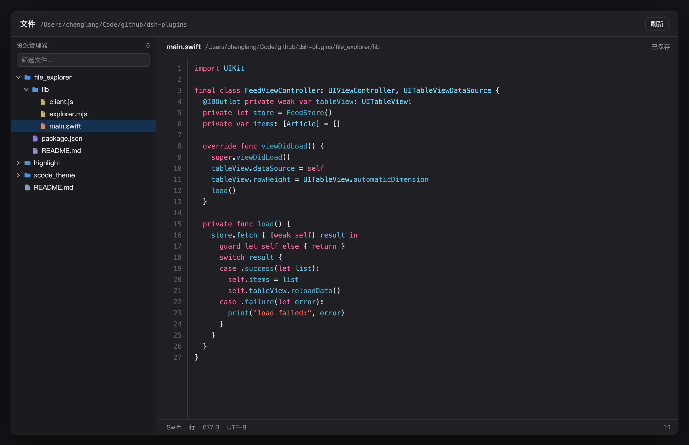

# dsh-file-explorer



给 DeepSeek Harness 加一个 **Xcode 项目导航器** 风格的文件浏览器：左侧栏底部多一个文件夹图标，
点进去是「工作区文件树 + 可编辑预览」的双栏面板。

- 左栏：文件夹点一下只**展开 / 收起**（不改名、不删除），文件点一下打开。
- 右栏：带**行号**和**语法高亮**的编辑器，主流代码文件都能预览；图片直接显示。
- 文件可以**直接改**，`⌘S` / `Ctrl+S` 保存，保存时带版本校验（磁盘被别人改过会提示，不会静默覆盖）。
- 配色全部走主题变量（`--dsw-alias-*` / `--shiki-token-*`），跟聊天里的代码块、以及 Xcode 主题是同一套颜色。

## 入口

安装后左侧栏底部图标行会多一个文件夹：

| 位置 | 说明 |
| --- | --- |
| `sidebar.panellist` | id `file-explorer`，order 20，图标 + 标题「文件」 |
| `main` | key `file-explorer`，点图标后主区域显示的面板 |

## 能做什么

| 操作 | 行为 |
| --- | --- |
| 点文件夹 | 展开 / 收起（懒加载，展开时才读磁盘） |
| 点文件 | 打开预览；文本进编辑器，图片进图片视图 |
| 输入 | 直接编辑（Tab 插入两个空格） |
| `⌘S` / `Ctrl+S` | 保存当前文件 |
| 顶部筛选框 | 按名字过滤当前已展开的层级 |
| 拖动树与编辑器之间的分隔条 | 调整树宽度 |
| 顶部刷新 | 重新读取所有已展开的目录 |
| 多工作区 | 顶部标题旁的下拉框切换 |

## 权限与边界

- 路径被锁在当前工作区根目录内：所有请求都先 `fs.contains(rootTarget, target)`，`../` 出不去。
- 文件夹只读：接口里没有 rename / delete / mkdir，点文件夹不会打开任何「目录内容视图」。
- 单文件上限：文本 2 MB、图片 12 MB；超过给提示，不阻塞界面。
- 忽略 `.git`、`node_modules`、`dist`、`build`、`.DS_Store` 等噪音目录。
- 二进制文件（含 NUL 字节）不按文本打开，给一行提示。

## 结构

```
file_explorer/
  package.json        bundle 形态：dsh.bundle.patch + dsh.client.platform=web
  cordis.patch.yml    把宿主半边 insert 进 profile
  lib/explorer.mjs    宿主半边：POST /api/file-explorer（roots / list / read / image / write）
  lib/client.js       浏览器半边：槽位注册 + 文件树 + 编辑器 + 轻量分词器
  icon.svg
```

宿主半边只做文件和目录的读写，不碰 UI；浏览器半边自带分词器，不依赖 shiki，
所以高亮颜色跟随主题变量而不是内置产物。

## 接口

`POST /api/file-explorer`，请求体 `{ action, ... }`：

| action | 入参 | 返回 |
| --- | --- | --- |
| `roots` | — | `{ roots: [{ id, title, path }], index }` |
| `list` | `root, path` | `{ entries: [{ name, type, size? }], truncated }` |
| `read` | `root, path` | `{ kind: 'text' \| 'binary' \| 'too-large', text?, version?, size }` |
| `image` | `root, path` | `{ mime, base64, size }` |
| `write` | `root, path, text, version?` | `{ version, bytes }`；版本过期返回 `stale` |

## 安装

```bash
dsh plugin add /Users/chenglang/Code/github/dsh-plugins/file_explorer
```

或者在「插件 → 从文件夹安装」里选这个目录，装完刷新窗口即可。

## 已知限制

- 只读预览不跟随磁盘变化：外部改动要手动「刷新」或重新打开文件（自动监听是下一步）。
- 高亮是轻量词法分词，不做语义分析；模板字符串、正则字面量内部可能按普通文本处理。
- 超大文件（> 2 MB）不打开，避免把编辑器卡死。
