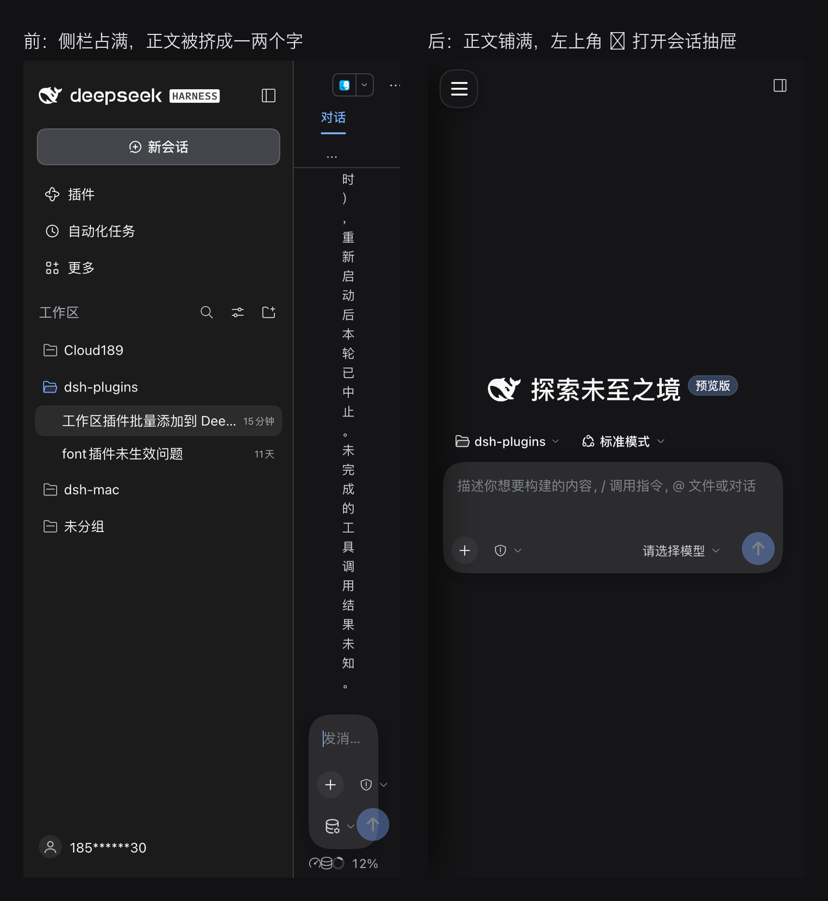

# dsh-mobile-fit

让 DeepSeek Harness 的 Web 界面在手机竖屏下能正常用。



## 为什么需要它

DSH 的前端是纯桌面布局：整份样式表里没有任何宽度断点，侧边栏固定占 280–300px。
在 390px 宽的手机上（或手机通过「局域网访问」打开的页面），侧边栏吃掉大半屏幕，
对话正文只剩几十像素——一行只能放一两个字，模型下拉还会溢出屏幕右边。

## 它做了什么

只在 `max-width: 820px` 时生效，桌面窗口完全不受影响：

| 位置 | 桌面 | 窄屏（本插件） |
| --- | --- | --- |
| 整体 | 图标栏 + 侧边栏 + 正文三列 | 正文单列铺满 |
| 侧边栏 | 常驻 280–300px | 从左侧滑出的抽屉 + 遮罩 |
| 拖拽把手 | 可拖动改宽 | 隐藏 |
| 代码块 / 表格 | 撑开 | 横向滚动，不撑破屏幕 |
| 弹窗 | 固定宽度 | 不超过屏幕 |
| 输入区 | — | 预留 iPhone 底部安全区 |

窄屏时左上角会出现一个圆形 ☰ 按钮——因为 dsh 的侧边栏收起后只剩 56px 图标栏，
如果整列藏起来就没有任何入口了。点它等同于点 dsh 自己的「打开侧边栏」，抽屉随即滑出：

- 点左上角 ☰ → 抽屉滑出（遮罩盖住正文）；
- 点遮罩、按 Esc、或点抽屉里的会话/工作区/导航项 → 抽屉收起；
- 展开/收起工作区分组、在搜索框里输入 → 不收起（避免打断操作）。

判断「侧边栏当前是开是关」靠读 shell 网格的**内联** `grid-template-columns`
首列宽度（56px = 只剩图标栏，280px = 面板展开）。内联样式是 dsh 自己写的，
插件只覆盖计算值，所以这个信号始终可靠。

## 安装

```bash
dsh plugin add /path/to/mobile_fit
```

安装后在手机（或把浏览器窗口拖窄）刷新页面即可。浏览器半边的改动需要重新加载页面才生效。

## 边界

- 只改样式与抽屉交互，不碰后端、不写任何配置。
- 只认 DSH 现有的结构类名后缀（`_frame` / `_sidebarCol` / `_centerCol`），
  这些后缀在 CSS Modules 里是稳定的；如果 DSH 大改布局，选择器需要跟着更新。
- 没有做平板横屏的精细适配：宽度超过 820px 就按桌面布局走。
